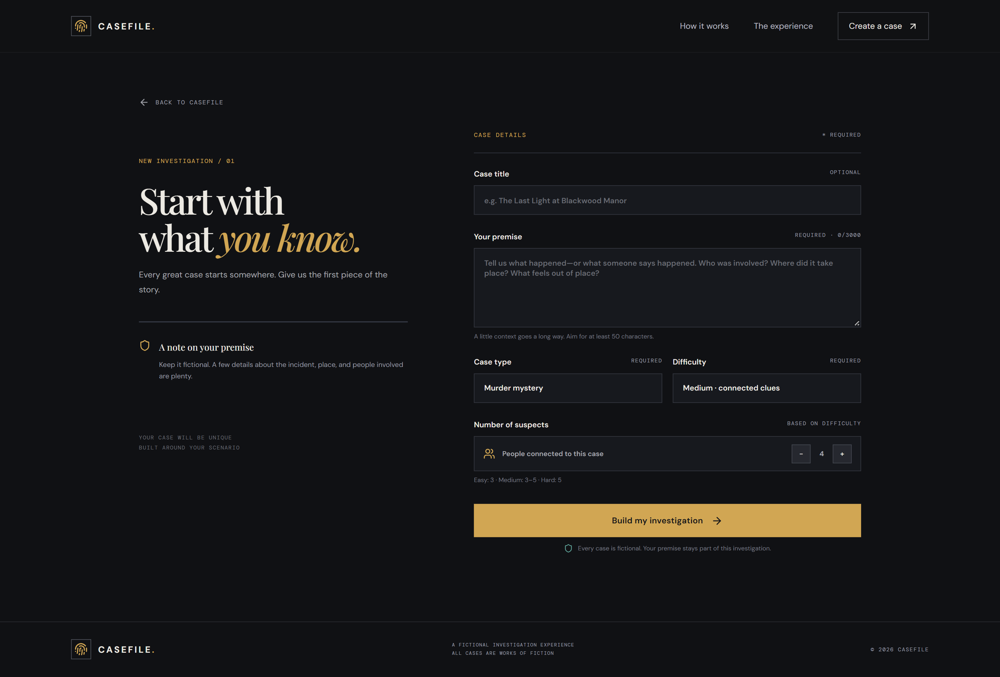
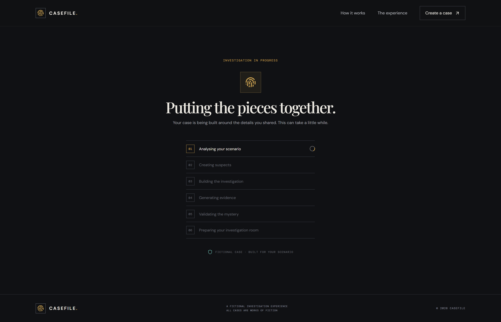
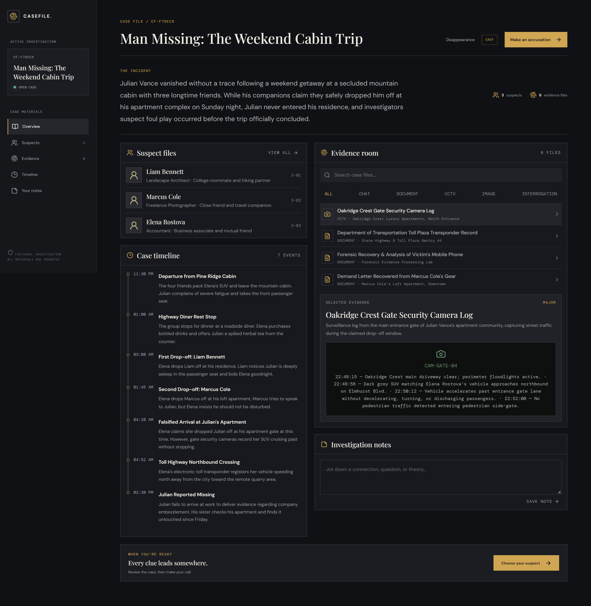
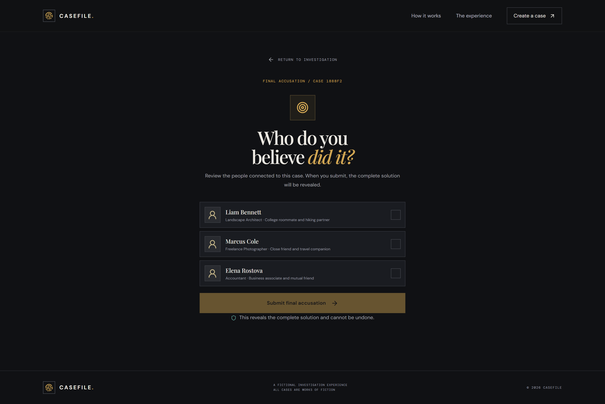
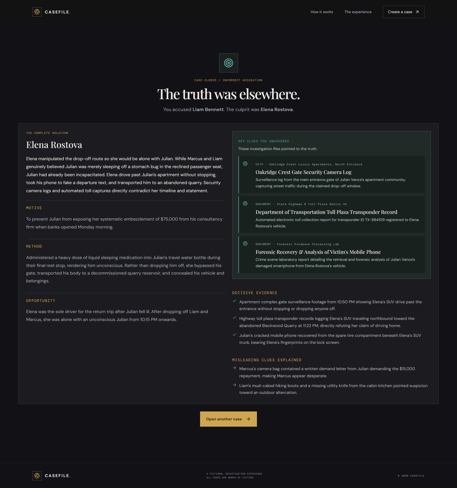

# Casefile

Casefile is an AI-powered, fictional investigation game. Describe an incident, let Gemini build a case around it, inspect the suspects and evidence, then make your accusation.

> All cases and materials generated by the app are fictional.

<p align="center">
  
</p>

## Features

- Create a unique fictional case from a premise, case type, difficulty, and suspect count.
- Explore suspect files, evidence, a timeline, and private investigation notes.
- Make one final accusation and receive the complete solution.
- Keep each browser session isolated with a signed, HTTP-only cookie.

## Screenshots

<p align="center">
  
  
</p>
<p align="center">
  
  
</p>
<p align="center">
  
</p>

## Tech stack

- Frontend: React, Vite, React Router, Axios, Framer Motion, and Lucide
- Backend: Node.js, Express, MongoDB/Mongoose, Gemini, and Zod
- Deployment: Vercel for the frontend and Render for the API

## Run locally

### Prerequisites

- Node.js 20 or newer
- A running MongoDB instance or MongoDB Atlas database
- A Google Gemini API key

### 1. Clone and install

```bash
git clone <your-repository-url>
cd ai_mystery

npm install
npm --prefix client install
npm --prefix server install
```

### 2. Create your local environment files

macOS/Linux:

```bash
cp server/.env.example server/.env
cp client/.env.example client/.env
```

PowerShell:

```powershell
Copy-Item server/.env.example server/.env
Copy-Item client/.env.example client/.env
```

Update `server/.env` with your own database connection, Gemini key, and private session secret. The client template already targets the local API by default.

| Variable | Where | Required | Description |
| --- | --- | --- | --- |
| `MONGODB_URI` | `server/.env` | Yes | Your MongoDB connection string. |
| `GEMINI_API_KEY` | `server/.env` | Yes | Your Google Gemini API key. |
| `SESSION_SECRET` | `server/.env` | Yes | A long, random secret used to sign session cookies. |
| `GEMINI_MODEL` | `server/.env` | No | Overrides the default Gemini model. |
| `VITE_API_URL` | `client/.env` | No | API URL; defaults to `http://localhost:5000/api/v1`. |

To generate a session secret locally:

```bash
node -e "console.log(require('node:crypto').randomBytes(32).toString('hex'))"
```

### 3. Start the app

```bash
npm run dev
```

Open `http://localhost:5173`. The frontend runs on port `5173` and the API runs on port `5000`.

## Project structure

```text
client/                 React + Vite frontend
server/                 Express API and MongoDB models
docs/screenshots/       Product screenshots used in this README
docs/                   API and AI-generation notes
render.yaml             Render Blueprint for the API
```

## Production deployment

The repository includes deployment configuration for both services:

1. On Render, create a Blueprint from this repository. [`render.yaml`](render.yaml) configures the API service, health check, build command, and Node version. Add `MONGODB_URI`, `GEMINI_API_KEY`, and `CLIENT_URL` in Render; `SESSION_SECRET` is generated by the Blueprint.
2. On Vercel, import the repository with `client` as the Root Directory. Set `VITE_API_URL` to `https://<your-render-service>.onrender.com/api/v1` and deploy.
3. Set Render's `CLIENT_URL` to the final Vercel site origin, such as `https://your-project.vercel.app`, then redeploy the API.

The included [`client/vercel.json`](client/vercel.json) preserves React client-side routes. See [docs/API.md](docs/API.md) for the API reference.

## Security

- Never commit `server/.env` or `client/.env`. They are ignored by Git.
- Commit only the safe `.env.example` templates.
- If a real credential is ever committed, revoke or rotate it immediately.
