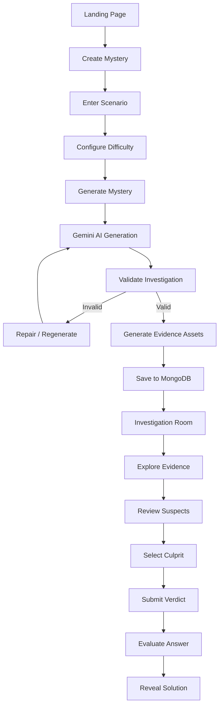
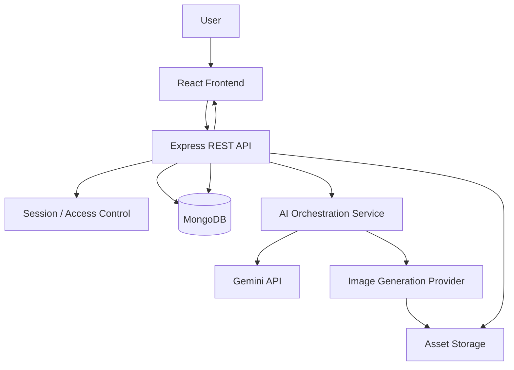

# AI MYSTERY ROOM
## Product Specification & Technical Source of Truth

**Document Type:** Software Product Specification (SSOT)  
**Development Methodology:** Spec-Driven Development (SDD)  
**Project Name:** AI Mystery Room  
**Version:** 1.0  
**Status:** Initial Development Specification  
**Frontend:** React.js  
**Backend:** Node.js + Express.js  
**Database:** MongoDB  
**AI Provider:** Google Gemini API  

---

# 1. PROJECT OVERVIEW

## 1.1 Product Vision

AI Mystery Room is an AI-powered interactive detective and investigation platform where users become investigators and solve fictional mysteries using evidence generated by artificial intelligence.

Users provide a short scenario, story, or mystery premise. The AI transforms that premise into a complete fictional investigation containing:

- A mystery storyline.
- A list of suspects.
- A culprit with a predefined motive.
- A chronological timeline of events.
- AI-generated evidence.
- Interrogation records.
- Digital conversations resembling WhatsApp messages.
- Photographic evidence.
- CCTV-style recordings and surveillance evidence.
- Hidden clues and contradictions.

The user investigates the available evidence, connects clues, identifies inconsistencies, and finally selects the person they believe committed the crime.

The system evaluates the user's decision against the original investigation solution and reveals the complete explanation.

## 1.2 Core Concept

**Give AI a story. Receive a mystery. Investigate the evidence. Find the culprit.**

Example:

A user enters:

> A businessman was found dead inside his locked office at 10 PM. Three employees had access to the office that evening. Everyone claims they left before 9 PM, but the security camera recorded someone entering the building at 9:30 PM.

The AI creates:

1. A fictional victim.
2. Three or more suspects.
3. A culprit with a believable motive.
4. A sequence of events explaining the crime.
5. WhatsApp conversations between suspects.
6. Security camera evidence.
7. Photographic clues.
8. Contradictions between suspect statements.
9. A final solution that explains everything.

The user explores the investigation and submits their final accusation.

## 1.3 Product Objectives

1. Make mystery-solving interactive rather than purely text-based.
2. Use AI to create unique investigations from user-provided scenarios.
3. Generate consistent evidence that supports one logically correct solution.
4. Allow users to investigate evidence independently.
5. Create an immersive detective experience.
6. Support different mystery themes and difficulty levels.
7. Make investigations replayable through different generated scenarios.

## 1.4 Target Audience

- Mystery and detective story enthusiasts.
- Casual gamers.
- Puzzle-solving enthusiasts.
- Students interested in interactive storytelling.
- Users interested in AI-generated experiences.

---

# 2. PRODUCT SCOPE

## 2.1 MVP Features

The initial release must include:

| Feature | Priority |
|---|---|
| Landing page | P0 |
| Create mystery form | P0 |
| AI mystery generation | P0 |
| Suspect profiles | P0 |
| Evidence management | P0 |
| WhatsApp-style chat evidence | P0 |
| Image evidence | P0 |
| CCTV-style evidence | P0 |
| Investigation dashboard | P0 |
| Evidence viewer | P0 |
| Suspect interrogation records | P1 |
| Investigation timeline | P0 |
| Culprit selection | P0 |
| Final verdict | P0 |
| Solution explanation | P0 |
| Difficulty selection | P1 |
| Investigation history | P1 |
| User authentication | P2 |
| Leaderboards | P2 |
| Multiplayer investigations | P2 |

P0 features are mandatory for the first functional release.

P1 features should be implemented after the main investigation workflow is stable.

P2 features are outside the initial MVP.

## 2.2 Out of Scope for MVP

The following features must not distract from the initial implementation:

- Real-time multiplayer investigations.
- Live multiplayer chat.
- User-created public mystery marketplace.
- Subscription and payment systems.
- Social networking.
- User-generated evidence uploads.
- Real-world police or criminal database integration.
- Native mobile applications.

---

# 3. USER JOURNEY

## 3.1 Main User Flow

The entire application revolves around the following workflow.

1. User visits the landing page.
2. User selects Create a Mystery.
3. User enters a scenario or story.
4. User selects mystery settings.
5. User clicks Generate Mystery.
6. Backend sends the scenario to Gemini.
7. AI generates the investigation structure and solution.
8. Backend validates the generated investigation.
9. Backend generates or prepares the evidence assets.
10. Investigation is saved in MongoDB.
11. User enters the investigation room.
12. User explores suspects, evidence, and timeline.
13. User connects clues and investigates contradictions.
14. User selects a culprit.
15. User submits the final accusation.
16. Backend evaluates the accusation.
17. Website displays the verdict and complete solution.

## 3.2 User Journey Diagram



---

# 4. FUNCTIONAL REQUIREMENTS

## 4.1 Landing Page

**Purpose:** Introduce the application and encourage users to create their first mystery.

Required components:

- Brand logo and navigation.
- Hero section.
- Main heading: "Every Mystery Has a Truth."
- Supporting description.
- Primary CTA: Create a Mystery.
- Secondary CTA: Explore How It Works.
- How It Works section.
- Feature showcase.
- Example investigation preview.
- Footer.

Expected behaviour:

- Create a Mystery navigates to the mystery creation page.
- How It Works scrolls to the relevant section.
- Navigation must work on desktop and mobile.
- The landing page must not require authentication.

## 4.2 Create Mystery Page

**Purpose:** Collect information required to generate an investigation.

### Required Inputs

| Field | Type | Required | Description |
|---|---|---|---|
| Mystery Title | Text | No | Optional investigation title |
| Scenario | Textarea | Yes | User-provided story or premise |
| Mystery Category | Select | Yes | Type of mystery |
| Difficulty | Select | Yes | Investigation difficulty |
| Number of Suspects | Select | Yes | Number of suspects |

### Mystery Categories

- Murder Mystery.
- Theft.
- Disappearance.
- Corporate Conspiracy.
- Blackmail.
- Historical Mystery.
- General Investigation.

### Difficulty Levels

**Easy**
- 3 suspects.
- 5–7 evidence items.
- Relatively obvious clues.
- Fewer contradictions.
- Simple timeline.

**Medium**
- 4 suspects.
- 8–12 evidence items.
- Multiple connected clues.
- Several misleading statements.
- Moderate reasoning required.

**Hard**
- 5 suspects.
- 13–18 evidence items.
- Complex relationships.
- Multiple contradictions.
- Hidden connections between evidence.
- More challenging reasoning.

These are generation targets, not guarantees that every generated case will have identical counts.

### Validation

- Scenario must not be empty.
- Scenario must contain at least 50 characters.
- Scenario must not exceed 3,000 characters.
- User must select a mystery category.
- User must select a difficulty.
- Number of suspects must remain within the configured difficulty limits.
- Invalid submissions must show clear error messages.
- Disable the Generate button while generation is running.

### Generation States

The UI must display meaningful generation progress:

1. Analysing your scenario.
2. Creating suspects.
3. Building the investigation.
4. Generating evidence.
5. Validating the mystery.
6. Preparing your investigation room.

The progress indicator must reflect actual backend job states, not a fabricated percentage.

## 4.3 AI Mystery Generation

This is the central feature of the application.

Gemini is responsible for generating the investigation's logical structure.

### AI Must Generate

1. Mystery title.
2. Mystery description.
3. Victim information, if applicable.
4. Suspect profiles.
5. Suspect relationships.
6. Culprit identity.
7. Motive.
8. Method.
9. Opportunity.
10. Timeline.
11. Evidence records.
12. Hidden clues.
13. Contradictions.
14. Suspect statements.
15. Final explanation.

### Critical AI Generation Rule

The AI must determine the actual solution BEFORE generating the evidence.

The evidence must support the predetermined solution.

The system must NEVER generate random evidence independently and then randomly assign a culprit.

**Required generation order:**

```text
1. Understand the user's scenario.
2. Create the underlying mystery.
3. Determine the actual culprit.
4. Define the culprit's motive.
5. Define the crime method.
6. Create the complete event timeline.
7. Create all suspects and their statements.
8. Generate evidence supporting the timeline.
9. Introduce deliberate but fair red herrings.
10. Validate the evidence against the solution.
11. Finalize the investigation.
```

### Culprit Requirements

Every investigation must have exactly one primary culprit.

The culprit must:

- Have a believable motive.
- Have an opportunity to commit the crime.
- Have a connection to the victim or incident.
- Have evidence connecting them to the crime.
- Have at least one meaningful contradiction or hidden clue.
- Be identifiable through the combined evidence.

Other suspects may have secrets, questionable behaviour, or secondary motives, but the solution must clearly distinguish them from the culprit.

### Investigation Consistency

The following rules are mandatory:

- All timestamps must agree with the master timeline.
- Suspect names must remain identical throughout the investigation.
- Evidence must not contradict established facts accidentally.
- The victim's identity must remain consistent.
- Every clue must have a defined purpose.
- Red herrings must be explainable.
- The final explanation must account for all major evidence.
- No evidence may reveal an impossible event.
- The final answer must match the stored culprit ID.

---

# 5. EVIDENCE SYSTEM

Evidence is the most important interactive part of AI Mystery Room.

Each investigation must contain different evidence types.

## 5.1 Evidence Categories

### A. Digital Messages

WhatsApp-style conversations between fictional characters.

Required data:

- Sender.
- Receiver.
- Message content.
- Timestamp.
- Conversation ID.
- Message status.
- Optional attachment reference.

Example:

```json
{
  "type": "chat",
  "title": "Conversation between Alex and Ryan",
  "conversation": [
    {
      "sender": "Alex",
      "message": "Did you reach the office?",
      "timestamp": "2026-10-12T20:15:00Z"
    },
    {
      "sender": "Ryan",
      "message": "No, I left an hour ago.",
      "timestamp": "2026-10-12T20:17:00Z"
    }
  ]
}
```

Frontend presentation:

- WhatsApp-inspired interface.
- Conversation header.
- Message bubbles.
- Message timestamps.
- Date separators.
- Optional attachment previews.

Important: These are fictional conversations. The frontend renders them from structured data. Do not use AI-generated screenshots as the primary message representation.

### B. Image Evidence

Examples:

- Crime scene photographs.
- Objects found at the scene.
- Photographs of suspicious locations.
- Damaged objects.
- Personal belongings.
- Photographs containing hidden clues.

Required data:

- Evidence ID.
- Image URL.
- Image description.
- Capture timestamp.
- Location.
- Related suspect IDs.
- Clue description.
- Whether it contains a major clue.

Images should be generated using an image-generation-capable model/provider.

Gemini should coordinate the generation process and provide image prompts.

The architecture must not assume that every Gemini text model can generate images.

### C. CCTV Evidence

CCTV evidence should provide surveillance-related information.

MVP representation:

- CCTV still frames.
- Camera identification.
- Recording timestamp.
- Location.
- Event description.
- Optional AI-generated footage transcript.
- Suspicious activity markers.

Example:

```json
{
  "type": "cctv",
  "title": "Main Entrance Camera",
  "cameraId": "CAM-01",
  "location": "Main Entrance",
  "timestamp": "2026-10-12T21:30:00Z",
  "description": "A person enters the building.",
  "transcript": [
    {
      "time": "21:30:12",
      "event": "Unknown person enters"
    },
    {
      "time": "21:34:45",
      "event": "Person leaves the camera frame"
    }
  ]
}
```

Full AI-generated video is not a mandatory MVP dependency.

The evidence system must support adding actual generated video URLs later without changing the overall investigation data model.

### D. Documents

Examples:

- Medical reports.
- Police reports.
- Financial records.
- Letters.
- Receipts.
- Access logs.
- Employee records.

The documents should be generated as structured fictional information and rendered using frontend templates.

### E. Interrogation Records

Each suspect can have an interrogation record.

Required fields:

- Suspect ID.
- Investigator questions.
- Suspect responses.
- Interview timestamp.
- Statements.
- Contradictions.
- Related evidence.

Example:

```json
{
  "suspectId": "suspect_02",
  "interview": [
    {
      "question": "Where were you at 9:30 PM?",
      "answer": "I was already at home.",
      "timestamp": "2026-10-12T21:45:00Z"
    }
  ]
}
```

## 5.2 Evidence Metadata

Every evidence item must include:

| Field | Description |
|---|---|
| id | Unique evidence ID |
| title | Evidence title |
| type | Evidence category |
| description | Short description |
| content | Type-specific structured data |
| timestamp | Evidence timestamp |
| location | Where it originated |
| relatedSuspects | Related suspect IDs |
| clueImportance | Minor, moderate, major |
| discoveryOrder | Display ordering |

Evidence must be stored independently from its frontend presentation.

## 5.3 Evidence Classification

Evidence must have three logical classifications:

- **Direct Evidence:** Strongly connects a suspect to an event.
- **Circumstantial Evidence:** Supports a theory through indirect facts.
- **Red Herring:** Creates suspicion but has a valid alternative explanation.

Classification can be stored internally.

The UI should not reveal these classifications to the player.

---

# 6. INVESTIGATION ROOM

## 6.1 Main Layout

The Investigation Room is the main gameplay interface.

It should resemble a modern detective investigation workspace.

Required layout:

**Left Sidebar**
- Investigation overview.
- Suspect list.
- Evidence categories.
- Timeline.
- Investigation notes.

**Main Workspace**
- Current selected evidence.
- Evidence viewer.
- Investigation information.
- Interactive evidence content.

**Right Panel**
- Case details.
- Suspect information.
- Investigation progress.
- Final accusation access.

Responsive layouts must adapt these panels for tablets and mobile devices.

## 6.2 Investigation Header

Display:

- Mystery title.
- Difficulty.
- Case ID.
- Investigation status.
- Number of suspects.
- Number of evidence items.

## 6.3 Suspect Profiles

Each suspect must display:

- Fictional photograph/avatar.
- Full name.
- Age.
- Occupation.
- Relationship to victim.
- Background.
- Possible motive.
- Alibi.
- Known connections.

Important:

Do not expose internal culprit information or hidden AI reasoning in the suspect profile API.

## 6.4 Evidence Explorer

Users must be able to:

- Browse all available evidence.
- Filter by evidence category.
- Search evidence titles.
- Open individual evidence.
- View related suspect information.
- Navigate between evidence items.

Evidence must be accessible without requiring a specific discovery order in the MVP.

## 6.5 Investigation Timeline

Display a chronological sequence of relevant events.

Timeline entries may include:

- Last confirmed victim sighting.
- Suspect arrival.
- Suspect departure.
- Messages exchanged.
- CCTV observations.
- Discovery of the incident.

The timeline should be based on the AI-generated master timeline.

Users should be able to identify inconsistencies between timeline entries and suspect statements.

## 6.6 Investigation Notes

MVP functionality:

- Allow users to write personal notes.
- Save notes to the investigation session.
- Edit and delete notes.
- Preserve notes after page refresh.

Notes must not affect the actual investigation solution.

---

# 7. FINAL ACCUSATION SYSTEM

## 7.1 Culprit Selection

Users must be presented with all suspects.

They must select exactly one suspect as their final accusation.

The interface should display:

- Suspect name.
- Photograph.
- Short profile.
- Selection indicator.
- Submit accusation button.

## 7.2 Submission

Before submitting:

- Show a confirmation dialog.
- Clearly explain that the verdict will reveal the solution.
- Prevent accidental double submission.

The backend must evaluate the selected suspect against the stored culprit ID.

## 7.3 Verdict Results

Three possible outcomes:

**Correct Verdict**

- Display success animation.
- Reveal the culprit.
- Explain the motive.
- Explain the method.
- Explain the opportunity.
- Show the decisive evidence.

**Incorrect Verdict**

- Display an unsuccessful investigation result.
- Reveal the actual culprit.
- Explain why the selected suspect was not responsible.
- Show evidence that disproves the accusation.

**Complete Solution**

Both outcomes should provide access to the full solution after submission.

The result must contain:

1. Actual culprit.
2. Motive.
3. Method.
4. Opportunity.
5. Chronological explanation.
6. Decisive evidence.
7. Explanation of misleading clues.
8. Explanation of other suspects' innocence.

The frontend must never determine whether an answer is correct independently.

The backend is the authority for verdict evaluation.

---

# 8. AI ARCHITECTURE

## 8.1 Gemini Integration

Gemini will be the primary AI provider.

All Gemini requests must happen through the backend.

Never expose the Gemini API key to the frontend.

### AI Responsibilities

| Responsibility | AI Component |
|---|---|
| Understand scenario | Gemini |
| Create storyline | Gemini |
| Generate suspects | Gemini |
| Determine culprit | Gemini |
| Build timeline | Gemini |
| Generate messages | Gemini |
| Create documents | Gemini |
| Create image prompts | Gemini |
| Generate image assets | Image-capable provider/model |
| Validate investigation | Gemini + deterministic backend validation |
| Explain final solution | Stored investigation solution |

## 8.2 Generation Architecture

Use a multi-stage generation pipeline.

**Stage 1: Scenario Analysis**

Gemini analyses the user's scenario and extracts:

- Main incident.
- Setting.
- Important characters.
- Possible motives.
- Mystery category.
- Story constraints.

**Stage 2: Mystery Blueprint**

Generate a complete internal investigation blueprint containing:

- Culprit.
- Motive.
- Method.
- Opportunity.
- Timeline.
- Suspect relationships.
- Important facts.
- Expected solution.

This blueprint must be stored privately.

**Stage 3: Suspect Generation**

Generate suspect profiles based on the blueprint.

**Stage 4: Evidence Generation**

Generate evidence that supports the established timeline and solution.

**Stage 5: Validation**

Check:

- Suspect references.
- Timestamp consistency.
- Evidence references.
- Timeline consistency.
- Culprit existence.
- Clue relationships.
- Solution completeness.

**Stage 6: Asset Generation**

Generate images and other media assets.

**Stage 7: Finalization**

Store the validated investigation and mark it as ready.

## 8.3 Structured AI Responses

Gemini responses must use structured JSON.

Do not depend on free-form text or Markdown parsing for core investigation data.

Define JSON schemas for:

- Mystery blueprint.
- Suspect.
- Evidence.
- Timeline.
- Interrogation.
- Final solution.

The backend must validate every AI response before saving it.

Invalid responses should enter a controlled repair or regeneration flow.

## 8.4 AI Prompt Rules

All system prompts must be maintained in separate backend files.

Suggested structure:

```text
server/
  src/
    ai/
      prompts/
        scenario-analysis.prompt.js
        mystery-blueprint.prompt.js
        suspect-generation.prompt.js
        evidence-generation.prompt.js
        validation.prompt.js
        solution-generation.prompt.js
```

Every prompt must include:

- Role definition.
- Task description.
- Required output schema.
- Constraints.
- Consistency rules.
- Forbidden behaviours.
- Example response where useful.

Do not hardcode large AI prompts inside Express controllers.

## 8.5 AI Cost and Reliability

Implement:

- Request timeout.
- Retry with limited attempts.
- Rate limiting.
- Token/output limits.
- Generation status tracking.
- Error logging.
- Model configuration through environment variables.
- AI provider abstraction.

The system should not regenerate an entire investigation when only one image asset fails.

Asset generation failures should be isolated.

---

# 9. TECHNICAL ARCHITECTURE

## 9.1 Technology Stack

### Frontend

- React.js.
- Vite.
- React Router.
- Tailwind CSS.
- Axios.
- Lucide React.
- Framer Motion for animations.

### Backend

- Node.js.
- Express.js.
- MongoDB.
- Mongoose.
- Google Gemini API SDK.
- Zod for schema validation.
- Multer where file uploads are needed.
- Rate-limiting middleware.

### Asset Storage

Use an external object-storage/image-hosting service for generated assets.

Suggested options:

- ImageKit.
- Cloudinary.
- Compatible S3 object storage.

MongoDB should store asset URLs and metadata, not binary image/video files.

### Development Tools

- Git.
- GitHub.
- ESLint.
- Prettier.
- Postman or equivalent API testing tool.

## 9.2 High-Level Architecture



## 9.3 Architecture Rules

1. Frontend and backend must be separate applications.
2. Frontend must communicate with backend through REST APIs.
3. All AI requests must pass through the backend.
4. All database operations must happen on the backend.
5. AI prompts must be separated from controllers.
6. Business logic must be separated from route definitions.
7. All environment variables must remain private.
8. Generated evidence must be stored using stable IDs.
9. The solution must never be included in public investigation responses.
10. The frontend must not contain hardcoded investigation data.

---

# 10. DATABASE DESIGN

Use MongoDB with Mongoose.

The following collections define the initial database architecture.

## 10.1 Users

MVP can support anonymous users.

Authentication is optional for the first release.

```javascript
{
  _id: ObjectId,
  username: String,
  email: String,
  createdAt: Date,
  updatedAt: Date
}
```

For anonymous users, use a secure server-managed session instead of requiring an account.

## 10.2 Investigations

```javascript
{
  _id: ObjectId,
  ownerId: ObjectId,
  sessionId: String,

  title: String,
  scenario: String,
  category: String,
  difficulty: String,

  status: String,

  suspectIds: [ObjectId],
  evidenceIds: [ObjectId],
  timelineIds: [ObjectId],

  solution: {
    culpritId: String,
    motive: String,
    method: String,
    opportunity: String,
    explanation: String,
    decisiveEvidenceIds: [String]
  },

  generationMetadata: {
    model: String,
    promptVersion: String,
    generationAttempts: Number
  },

  createdAt: Date,
  updatedAt: Date
}
```

Important:

The `solution` field is private backend data.

Never return the complete Investigation document directly to the frontend.

## 10.3 Suspects

```javascript
{
  _id: ObjectId,
  investigationId: ObjectId,

  suspectId: String,
  name: String,
  age: Number,
  occupation: String,
  imageUrl: String,

  background: String,
  relationshipToVictim: String,
  possibleMotive: String,
  alibi: String,

  createdAt: Date
}
```

## 10.4 Evidence

```javascript
{
  _id: ObjectId,
  investigationId: ObjectId,

  evidenceId: String,
  title: String,
  type: String,
  description: String,

  content: Object,

  timestamp: Date,
  location: String,

  relatedSuspects: [String],
  clueImportance: String,

  internalClassification: String,
  internalExplanation: String,

  createdAt: Date
}
```

The `content` field holds type-specific information.

The `internalClassification` and `internalExplanation` fields must never be exposed before the verdict.

## 10.5 Timeline

```javascript
{
  _id: ObjectId,
  investigationId: ObjectId,

  eventId: String,
  title: String,
  description: String,

  timestamp: Date,
  relatedSuspects: [String],
  relatedEvidence: [String],

  createdAt: Date
}
```

## 10.6 Investigation Sessions

```javascript
{
  _id: ObjectId,
  investigationId: ObjectId,

  sessionId: String,

  status: String,

  notes: [
    {
      noteId: String,
      content: String,
      createdAt: Date,
      updatedAt: Date
    }
  ],

  selectedSuspectId: String,

  verdict: {
    submitted: Boolean,
    isCorrect: Boolean,
    submittedAt: Date
  },

  createdAt: Date,
  updatedAt: Date
}
```

## 10.7 Generation Jobs

```javascript
{
  _id: ObjectId,
  investigationId: ObjectId,

  status: String,

  currentStage: String,

  stages: [
    {
      name: String,
      status: String,
      error: String,
      startedAt: Date,
      completedAt: Date
    }
  ],

  error: String,

  createdAt: Date,
  updatedAt: Date
}
```

## 10.8 Database Rules

- Every investigation must have a unique ID.
- Every suspect ID must be unique within an investigation.
- Every evidence ID must be unique within an investigation.
- Every timeline event must belong to an investigation.
- Every related suspect reference must resolve.
- The culprit ID must reference an existing suspect.
- Every decisive evidence reference must resolve.
- Investigation and session relationships must be validated.
- Use indexes on investigationId, sessionId, ownerId and status where appropriate.

---

# 11. API SPECIFICATION

Base URL:

```text
/api/v1
```

All APIs should return consistent JSON responses.

Standard response:

```json
{
  "success": true,
  "message": "Operation successful",
  "data": {}
}
```

Error response:

```json
{
  "success": false,
  "message": "Something went wrong",
  "error": {
    "code": "VALIDATION_ERROR"
  }
}
```

## 11.1 Investigation APIs

| Method | Endpoint | Purpose |
|---|---|---|
| POST | `/investigations` | Create investigation request |
| GET | `/investigations/:id` | Get public investigation details |
| GET | `/investigations/:id/status` | Get generation status |
| GET | `/investigations/:id/suspects` | Get suspects |
| GET | `/investigations/:id/evidence` | Get evidence |
| GET | `/investigations/:id/evidence/:evidenceId` | Get specific evidence |
| GET | `/investigations/:id/timeline` | Get timeline |
| POST | `/investigations/:id/notes` | Create investigation note |
| PATCH | `/investigations/:id/notes/:noteId` | Update note |
| DELETE | `/investigations/:id/notes/:noteId` | Delete note |

## 11.2 Verdict APIs

| Method | Endpoint | Purpose |
|---|---|---|
| POST | `/investigations/:id/verdict` | Submit culprit selection |
| GET | `/investigations/:id/result` | Get verdict result |

Verdict submission:

```json
{
  "suspectId": "suspect_02"
}
```

The server must:

1. Validate the investigation.
2. Validate the suspect ID.
3. Verify session ownership.
4. Check whether a verdict was already submitted.
5. Compare the suspect ID with the stored culprit ID.
6. Save the result.
7. Return the result and solution.

Verdict submission must be idempotent or protected against duplicate submissions.

## 11.3 Generation API Behaviour

`POST /investigations`

Request:

```json
{
  "scenario": "A businessman was found dead...",
  "category": "murder",
  "difficulty": "medium",
  "suspectCount": 4
}
```

Response:

```json
{
  "success": true,
  "data": {
    "investigationId": "INV_12345",
    "generationJobId": "JOB_12345",
    "status": "generating"
  }
}
```

Generation must run asynchronously.

The frontend should poll:

`GET /investigations/:id/status`

until the investigation reaches one of these states:

- `generating`
- `validating`
- `generating_assets`
- `ready`
- `failed`

Only `ready` investigations can be entered.

---

# 12. FRONTEND PAGE STRUCTURE

## 12.1 Required Routes

| Route | Page |
|---|---|
| `/` | Landing page |
| `/create` | Create mystery |
| `/generating/:id` | Generation progress |
| `/investigation/:id` | Investigation dashboard |
| `/investigation/:id/suspects` | Suspect list |
| `/investigation/:id/evidence` | Evidence explorer |
| `/investigation/:id/timeline` | Timeline |
| `/investigation/:id/accuse` | Final accusation |
| `/investigation/:id/result` | Verdict and solution |

## 12.2 Suggested Folder Structure

```text
ai-mystery-room/
│
├── client/
│   ├── src/
│   │   ├── assets/
│   │   ├── components/
│   │   │   ├── common/
│   │   │   ├── layout/
│   │   │   ├── evidence/
│   │   │   ├── suspects/
│   │   │   └── investigation/
│   │   │
│   │   ├── pages/
│   │   │   ├── Home/
│   │   │   ├── CreateMystery/
│   │   │   ├── Generating/
│   │   │   ├── Investigation/
│   │   │   ├── Accusation/
│   │   │   └── Results/
│   │   │
│   │   ├── hooks/
│   │   ├── services/
│   │   ├── context/
│   │   ├── utils/
│   │   ├── routes/
│   │   ├── App.jsx
│   │   └── main.jsx
│   │
│   ├── package.json
│   └── vite.config.js
│
├── server/
│   ├── src/
│   │   ├── config/
│   │   ├── controllers/
│   │   ├── routes/
│   │   ├── models/
│   │   ├── middleware/
│   │   ├── services/
│   │   │   ├── ai/
│   │   │   ├── investigation/
│   │   │   ├── evidence/
│   │   │   └── storage/
│   │   ├── validators/
│   │   ├── prompts/
│   │   ├── utils/
│   │   ├── jobs/
│   │   └── app.js
│   │
│   ├── package.json
│   └── server.js
│
├── docs/
│   ├── SPEC.md
│   ├── API.md
│   ├── DATABASE.md
│   └── AI_GENERATION.md
│
├── .gitignore
└── README.md
```

This is the proposed structure, not a requirement to create every file immediately.

---

# 13. UI/UX DESIGN SPECIFICATION

## 13.1 Design Direction

The interface should feel like a premium detective investigation platform.

Visual inspiration:

- Modern detective workstations.
- Investigation boards.
- Dark cinematic environments.
- Digital forensics interfaces.
- Premium mystery games.

Avoid making the website look like a generic AI chatbot or a standard admin dashboard.

## 13.2 Colour Palette

| Colour | Hex | Usage |
|---|---|---|
| Midnight Black | `#101114` | Main background |
| Charcoal | `#191C22` | Cards and panels |
| Elevated Surface | `#222630` | Secondary surfaces |
| Border | `#343946` | Borders and dividers |
| Off White | `#F1F2F4` | Primary text |
| Muted Grey | `#A0A5B1` | Secondary text |
| Crimson | `#C83B46` | Danger and crime indicators |
| Amber | `#D9A441` | Clues and important evidence |
| Teal | `#43A99C` | Investigation status |
| Green | `#55B887` | Correct verdict |

## 13.3 Typography

Recommended fonts:

- Primary: Inter.
- Headings: Space Grotesk.
- Optional investigation metadata: IBM Plex Mono.

## 13.4 UI Principles

1. Use dark mode as the default theme.
2. Maintain strong text readability.
3. Use subtle animations.
4. Avoid unnecessary gradients.
5. Maintain consistent spacing.
6. Use cards for evidence and suspects.
7. Use visual distinction between evidence types.
8. Provide loading skeletons.
9. Provide empty states and error states.
10. Keep mobile layouts usable.

## 13.5 Important Visual Components

- Investigation sidebar.
- Evidence cards.
- Suspect profile cards.
- WhatsApp-style chat viewer.
- CCTV viewer.
- Image evidence lightbox.
- Timeline component.
- Investigation notes panel.
- Culprit selection interface.
- Verdict reveal screen.

## 13.6 Responsive Behaviour

**Desktop**
- Three-panel investigation layout.
- Persistent navigation.
- Large evidence viewer.

**Tablet**
- Two-panel layout.
- Collapsible sidebar.

**Mobile**
- Single-panel layout.
- Bottom navigation or drawer.
- Full-screen evidence viewer.
- Horizontally scrollable suspect cards where appropriate.

---

# 14. SECURITY AND DATA PROTECTION

Security is essential because the culprit and solution must remain hidden.

## 14.1 Secret Protection

- Gemini API key must exist only on the backend.
- Database credentials must not be exposed.
- Storage credentials must not be exposed.
- Use environment variables.
- Never commit `.env` files.

## 14.2 Solution Protection

This is a critical requirement.

The following information must never be returned through public APIs before verdict submission:

- Culprit ID.
- Motive details.
- Hidden evidence classifications.
- Internal clue explanations.
- Private investigation blueprint.
- Full solution.
- AI internal reasoning.

Use explicit response DTOs or serializers to prevent accidental leakage.

Do not rely on frontend hiding or CSS to protect solution data.

## 14.3 Session Security

For anonymous users:

- Generate secure session identifiers.
- Store session ownership on the backend.
- Use secure, HttpOnly cookies where supported.
- Configure SameSite and Secure attributes appropriately.
- Validate session ownership on every private investigation endpoint.
- Apply CSRF protection where cookie-based authentication requires it.

## 14.4 API Protection

Implement:

- Request validation.
- Rate limiting.
- CORS restrictions.
- Input sanitization.
- Error handling.
- Request size limits.
- Protection against prompt injection.
- Protection against unauthorized investigation access.

## 14.5 Fictional Content Protection

All generated investigations must be clearly labelled as fictional.

- Use fictional identities.
- Do not create evidence intended to impersonate real people.
- Do not use real private conversations or personal photographs.
- Avoid presenting generated documents as authentic legal or police records.
- Display an appropriate fictional-investigation disclaimer.

---

# 15. ERROR HANDLING

The application must gracefully handle failures.

| Situation | Expected Behaviour |
|---|---|
| Gemini API unavailable | Show generation error and retry option |
| Invalid AI JSON | Attempt controlled repair |
| AI generation timeout | Mark job appropriately and allow retry |
| Image generation failure | Use a fallback placeholder or retry asset |
| MongoDB unavailable | Show service error |
| Invalid investigation ID | Display not found page |
| Unauthorized access | Return 401/403 |
| Invalid suspect ID | Return validation error |
| Duplicate verdict | Return existing result without resubmitting |
| Missing evidence asset | Show fallback UI |
| Network interruption | Preserve session and allow reconnection |

Do not display raw server stack traces or provider credentials to users.

---

# 16. NON-FUNCTIONAL REQUIREMENTS

## Performance

- Landing page should load quickly.
- Use lazy loading for evidence images.
- Paginate or limit large evidence collections.
- Avoid loading all media assets at once.
- Use database indexes.
- Cache appropriate read-only information.
- Keep API responses reasonably small.

## Reliability

- Generation jobs must have explicit states.
- Partial asset failures must not destroy valid investigation data.
- Failed jobs must be recoverable where possible.
- Verdict evaluation must be deterministic.
- Database updates must preserve investigation consistency.

## Maintainability

- Follow modular architecture.
- Separate UI from business logic.
- Use reusable components.
- Centralize API communication.
- Keep prompts version-controlled.
- Use consistent naming conventions.
- Use centralized error handling.
- Validate all incoming and outgoing AI data.

## Accessibility

- Keyboard navigation.
- Visible focus indicators.
- Appropriate contrast.
- Accessible labels.
- Semantic HTML.
- Alt text for evidence images.

---

# 17. TESTING REQUIREMENTS

## 17.1 Frontend Testing

Test:

- Landing page navigation.
- Form validation.
- Mystery generation loading states.
- Suspect display.
- Evidence filtering.
- Evidence viewer.
- Timeline rendering.
- Note creation and editing.
- Culprit selection.
- Verdict display.
- Responsive layouts.

## 17.2 Backend Testing

Test:

- Investigation creation.
- Gemini response validation.
- Suspect creation.
- Evidence creation.
- Timeline generation.
- Database relationships.
- Session authorization.
- Evidence retrieval.
- Solution protection.
- Verdict evaluation.
- Error handling.

## 17.3 AI Testing

Generate at least 10 different test investigations.

Check:

- Does every investigation have exactly one culprit?
- Are all suspects unique?
- Are evidence references valid?
- Are timestamps consistent?
- Is the culprit identifiable?
- Are red herrings explainable?
- Does the solution explain all major evidence?
- Can the validation system detect contradictory evidence?

## 17.4 Critical Security Tests

The following tests are mandatory:

1. Request the public investigation API and check that the culprit is not exposed.
2. Request evidence APIs and check that hidden classifications are not exposed.
3. Attempt to access another session's investigation.
4. Attempt to submit a verdict using an invalid suspect ID.
5. Attempt to submit multiple verdicts.
6. Inspect frontend bundles for API keys.
7. Attempt to access solution data before submission.

---

# 18. IMPLEMENTATION PHASES

Development must follow a dependency-aware sequence.

Every phase must leave the application in a working state.

## Phase 1: Project Foundation

- Create client and server.
- Configure React and Vite.
- Configure Express.
- Connect MongoDB.
- Configure environment variables.
- Create health-check endpoint.
- Configure Tailwind CSS.
- Set up routing.

**Completion:** Frontend and backend communicate successfully, and MongoDB connects.

## Phase 2: Frontend Foundation

- Implement landing page.
- Implement navigation.
- Implement mystery creation page.
- Implement validation.
- Create shared UI components.
- Implement responsive layouts.

**Completion:** Users can navigate and submit a valid mystery form using temporary development data.

## Phase 3: Backend Investigation Foundation

- Create Mongoose models.
- Implement investigation routes.
- Implement session management.
- Implement validation.
- Implement investigation retrieval.
- Implement API error handling.

**Completion:** Investigation data can be created, stored and retrieved without AI.

## Phase 4: Gemini Integration

- Configure Gemini SDK.
- Create AI service.
- Write prompt templates.
- Implement scenario analysis.
- Implement mystery blueprint generation.
- Implement suspect generation.
- Implement evidence generation.
- Implement structured output validation.

**Completion:** A scenario produces a structured investigation with a predetermined culprit.

## Phase 5: Investigation Validation

- Validate suspect references.
- Validate evidence references.
- Validate timestamps.
- Validate timeline consistency.
- Validate culprit existence.
- Validate solution completeness.
- Implement repair and retry logic.

**Completion:** Invalid investigations are rejected or repaired before becoming playable.

## Phase 6: Evidence Generation

- Implement chat evidence.
- Implement document evidence.
- Integrate image generation.
- Implement CCTV-style evidence.
- Integrate asset storage.
- Add asset fallbacks.

**Completion:** Investigations contain playable, readable evidence items.

## Phase 7: Investigation Room

- Implement investigation dashboard.
- Implement suspect explorer.
- Implement evidence explorer.
- Implement chat viewer.
- Implement image viewer.
- Implement CCTV viewer.
- Implement timeline.
- Implement investigation notes.

**Completion:** Users can investigate the complete case.

## Phase 8: Verdict and Results

- Implement suspect selection.
- Implement confirmation dialog.
- Implement verdict API.
- Implement result screen.
- Implement solution explanation.
- Add correct and incorrect result states.

**Completion:** The entire investigation workflow works from creation to final solution.

## Phase 9: Testing and Polish

- Test AI consistency.
- Test security.
- Test API failures.
- Test responsive design.
- Optimize performance.
- Fix UI issues.
- Prepare deployment.

**Completion:** The MVP is stable and deployable.

---

# 19. ENVIRONMENT VARIABLES

Frontend `.env`:

```env
VITE_API_URL=http://localhost:5000/api/v1
```

Backend `.env`:

```env
PORT=5000
NODE_ENV=development

MONGODB_URI=

GEMINI_API_KEY=
GEMINI_MODEL=

IMAGE_PROVIDER=
IMAGE_PROVIDER_API_KEY=

STORAGE_PROVIDER=
IMAGEKIT_PUBLIC_KEY=
IMAGEKIT_PRIVATE_KEY=
IMAGEKIT_URL_ENDPOINT=

CLIENT_URL=http://localhost:5173

SESSION_SECRET=
```

Rules:

- Never expose backend environment variables through Vite.
- Never commit actual secrets.
- Validate required environment variables during server startup.
- Use the same configuration approach for development and production.
- Model names must be configurable rather than hardcoded throughout the codebase.

---

# 20. DEFINITION OF DONE

The MVP is considered complete only when all the following conditions are satisfied.

### Application

- [ ] Landing page is functional.
- [ ] Mystery creation form works.
- [ ] Frontend and backend are connected.
- [ ] MongoDB stores investigation data.
- [ ] Gemini generates investigations.

### Investigation Generation

- [ ] One predefined culprit per investigation.
- [ ] Suspects have complete profiles.
- [ ] Evidence is logically connected.
- [ ] Timeline is consistent.
- [ ] AI validation is functional.
- [ ] Generated images are accessible.
- [ ] Failed asset generation is recoverable.

### Gameplay

- [ ] Investigation dashboard works.
- [ ] Suspect profiles are accessible.
- [ ] Evidence can be explored.
- [ ] Chat evidence renders correctly.
- [ ] CCTV evidence renders correctly.
- [ ] Image evidence renders correctly.
- [ ] Timeline works.
- [ ] Investigation notes persist.

### Verdict

- [ ] User can select one suspect.
- [ ] Backend evaluates the answer.
- [ ] Correct verdict works.
- [ ] Incorrect verdict works.
- [ ] Complete solution is revealed after submission.
- [ ] Duplicate submissions are handled.

### Security

- [ ] API keys are protected.
- [ ] Culprit is hidden before submission.
- [ ] Private investigation data is protected.
- [ ] Session authorization works.
- [ ] Input validation works.

### Final

- [ ] Desktop responsive design works.
- [ ] Mobile responsive design works.
- [ ] No critical console errors.
- [ ] No critical backend errors.
- [ ] README and setup instructions are complete.

---

# 21. CODING RULES FOR CODEX

These rules are mandatory throughout development.

## 21.1 General Development Rules

1. Treat this document as the authoritative product specification.
2. Do not introduce features outside the defined scope without explicit approval.
3. Do not replace the selected technology stack.
4. Do not create unnecessary abstractions.
5. Keep code modular and maintainable.
6. Avoid duplicated business logic.
7. Use reusable React components.
8. Use consistent naming conventions.
9. Keep API routes RESTful.
10. Use centralized error handling.

## 21.2 Implementation Rules

1. Build incrementally.
2. Do not implement the entire application in one step.
3. Every implementation step must leave the project runnable.
4. Do not move to the next major phase while the current phase has failing critical tests.
5. Use temporary mock data only when the relevant backend feature has not yet been implemented.
6. Clearly separate mock data from production data.
7. Do not hardcode AI-generated investigation results.
8. Do not expose internal AI solution information.
9. Do not bypass backend validation for convenience.
10. Do not silently change the database schema.

## 21.3 Dependency Rules

- Install only necessary dependencies.
- Avoid libraries that duplicate existing functionality.
- Document why a new dependency is needed.
- Check compatibility before installing.
- Keep client and server dependencies separate.

## 21.4 Database Rules

- All schema changes must be deliberate.
- Preserve existing data when changing models.
- Document migration or data transformation requirements.
- Validate database references.
- Never store sensitive credentials in MongoDB documents unnecessarily.

## 21.5 UI Rules

- Maintain the established design system.
- Do not introduce unrelated colour palettes.
- Use consistent typography and spacing.
- Maintain responsive behaviour.
- Every button must perform a real action.
- Every loading state must have an appropriate completion or failure state.

## 21.6 AI Rules

- Gemini must generate structured data.
- Validate AI outputs before database persistence.
- Store the solution separately from public evidence.
- Maintain consistent suspect and evidence IDs.
- Do not allow the frontend to decide the culprit.
- Do not trust unvalidated AI output.
- Use controlled retries.
- Never reveal internal reasoning or the mystery blueprint before the verdict.

---

# 22. IMPORTANT PRODUCT DECISIONS

The following decisions are fixed for the initial MVP.

| Decision | Specification |
|---|---|
| Product type | AI-powered mystery investigation website |
| Application architecture | MERN |
| Frontend | React + Vite |
| Backend | Node.js + Express |
| Database | MongoDB |
| AI | Google Gemini |
| Authentication | Anonymous sessions initially |
| Mystery generation | Asynchronous |
| Culprit selection | Exactly one |
| Evidence | Structured AI-generated content |
| Chat screenshots | Rendered from structured messages |
| Images | Generated through image-capable provider |
| CCTV | Frames and event records in MVP |
| Video generation | Future extension |
| Final verdict | Backend evaluated |
| Solution visibility | Only after verdict submission |
| Primary theme | Dark detective interface |
| MVP priority | Complete investigation experience |

---

# 23. FUTURE EXPANSION

These features can be considered after the MVP.

### Interactive Investigation
- AI-powered suspect questioning.
- Dynamic interrogation.
- Ask suspects custom questions.
- AI-generated responses based on their character and hidden knowledge.

### Advanced Evidence
- AI-generated video footage.
- Audio recordings.
- Voice messages.
- Interactive crime scene exploration.
- Fingerprint and forensic evidence.

### Gamification
- Investigation score.
- Time-based challenges.
- Hint system.
- Achievement badges.
- Global leaderboard.
- Daily mystery challenges.

### Social Features
- Shareable investigations.
- Multiplayer detective mode.
- Collaborative investigations.
- User-created mystery scenarios.

### Personalization
- Mystery generation based on user preferences.
- Difficulty adaptation.
- Multiple investigation themes.
- Investigation history and statistics.

---

# 24. FINAL PRODUCT REQUIREMENT

The ultimate goal is not simply to generate an AI-written detective story.

The goal is to create a **playable, logically consistent investigation experience**.

Every investigation must have:

1. A believable mystery.
2. A predetermined and internally stored solution.
3. Multiple suspects with distinct identities and motives.
4. Evidence presented through different media formats.
5. A consistent chronological timeline.
6. Meaningful clues and fair red herrings.
7. One logically defensible culprit.
8. A satisfying final reveal.

**Most important development principle:**

The AI creates the mystery, but the backend controls the truth.

The frontend presents the investigation, the user solves the case, and the backend evaluates the verdict against the original solution.

This document is the authoritative specification for AI Mystery Room. All implementation decisions must remain consistent with it. Any change to the product scope, technical architecture, data models, API contracts, or core gameplay must be reflected in an updated specification before implementation.

---

**END OF SPECIFICATION**

Document Version: 1.0  
Project: AI Mystery Room  
Development Approach: Spec-Driven Development